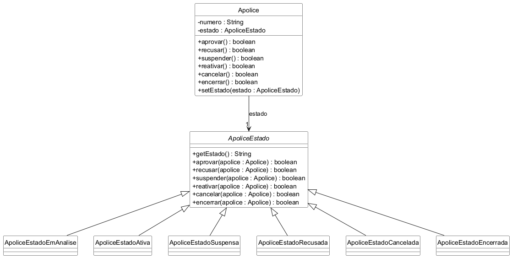
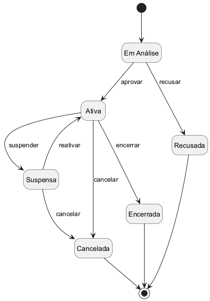

# State

Trabalho da disciplina Aspectos Avançados em Engenharia de Software.

Exemplo do padrão State em Java, com testes em JUnit 5. O tema é o mesmo da
seguradora usada nos trabalhos anteriores, agora acompanhando a situação de uma
apólice: ela começa em análise, pode ser aprovada ou recusada, e depois de ativa
pode ser suspensa por falta de pagamento, reativada, cancelada ou encerrada no
fim da vigência.

Cada situação é uma classe de estado, e é o estado atual que decide se a ação é
permitida e para qual estado a apólice vai. Assim a classe `Apolice` não precisa
de um monte de `if` para saber o que pode ou não pode fazer em cada situação.

## Diagrama de classes

## Diagrama de estados

